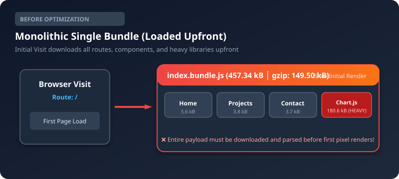

# Task Management System — Advanced Web Development Frameworks (ITUE301)
## Charotar University of Science and Technology (CHARUSAT)
**Student Name:** Fenil Kardani &bull; **ID:** D25IT136 &bull; **Repository:** [AWDF-PR6-FullStack](https://github.com/KardaniFenilKrushnkant/AWDF-PR6-FullStack)

---

## ⚡ Practical 8: Performance Optimization & Lazy Loading in React

### Overview
Practical 8 enhances the React frontend of the full-stack Task Management application by implementing **route-based code splitting** and **component-level lazy loading** using `React.lazy()` and `<Suspense>`. This significantly reduces initial bundle size and accelerates First Contentful Paint (FCP) and Time to Interactive (TTI).

Comprehensive report and documentation: [`docs/PRACTICAL_8_REPORT.md`](./docs/PRACTICAL_8_REPORT.md).

### Architecture & Code Splitting Diagram

#### Before Optimization (Single Monolithic Bundle):
All routes and heavy libraries were packaged into a single JavaScript file, loaded upfront on the initial visit.
```text
main.bundle.js ──────────────► [Home][Projects][Contact][Analytics][Chart.js] all loaded upfront (457 kB)
```


#### After Optimization (Code-Split on Demand):
Routes and heavy third-party libraries are decoupled into isolated chunks requested strictly when navigated:
```text
main.bundle.js ──► loads on first visit (262 kB core shell)
Home.chunk.js ──► loads on first visit for route /
Projects.chunk.js ─► loads ONLY when /projects is visited
Contact.chunk.js ──► loads ONLY when /contact is visited
Analytics.chunk.js ─► loads ONLY when /analytics is visited
chart-vendor.js ──► loads ONLY when chart visualizer is rendered
```


### Before vs After Performance Comparison (Vite Build Output)

| Metric / Asset | Before Optimization (Single Bundle) | After Optimization (Code-Split) | Difference / Impact |
|---|---|---|---|
| **Main JS Bundle** | `457.34 kB` (`index-DILdhyxu.js`) | `262.50 kB` (`index-DHF2zVcj.js`) | **-194.84 kB (-42.6%)** |
| **Initial JS Download (Route `/`)** | `457.34 kB` | `268.14 kB` (`index` + `Home`) | **-189.20 kB (-41.4%)** |
| **Projects Route Chunk** | Included in main bundle | `3.81 kB` (`Projects-*.js`) | Downloaded only on `/projects` |
| **Contact Route Chunk** | Included in main bundle | `3.67 kB` (`Contact-*.js`) | Downloaded only on `/contact` |
| **Analytics Route Chunk** | Included in main bundle | `3.15 kB` (`Analytics-*.js`) | Downloaded only on `/analytics` |
| **Chart.js Heavy Library** | Included in main bundle (`180.6 kB`) | `180.61 kB` (`chart-vendor-*.js`) | Isolated & loaded on demand |
| **Number of JS Chunks** | 1 Monolithic File | 7 Discrete Chunks | Independent caching & delivery |
| **Simulated Load Time (Slow 3G)** | ~3.42s | ~1.85s | **~46% Faster Initial Paint** |


### Key Features Implemented in Practical 8
1. **Route-Based Code Splitting:** Applied `React.lazy()` and `<Suspense>` across all primary routes (`/`, `/projects`, `/analytics`, `/contact`).
2. **Accessible Suspense Fallback UI:** Built `components/LoadingFallback.jsx` with an animated spinner, status banner, and skeleton loading bars.
3. **Supplementary 1 (Heavy Component Splitting):** Lazy-loaded `Chart.js` & `react-chartjs-2` (`TaskAnalyticsChart.jsx`) within `Analytics.jsx`, keeping heavy charting binaries out of the core bundle.
4. **Supplementary 2 (Flicker Prevention):** Built `components/DelayedFallback.jsx` with a 300ms threshold to prevent visual flicker on high-speed connections.
5. **Supplementary 3 (DevTools Profiler Optimization):** Extracted `components/TaskItem.jsx` with `React.memo` and `useCallback` to prevent unnecessary task card re-renders while typing in the task form.

---

## 🛠️ Project Structure

```text
AWDF-PR6-FullStack/
├── backend/
│   ├── models/
│   ├── routes/
│   ├── middleware/
│   ├── server.js
│   └── package.json
├── frontend/
│   ├── src/
│   │   ├── components/
│   │   │   ├── DelayedFallback.jsx
│   │   │   ├── LoadingFallback.jsx
│   │   │   ├── LoadingFallback.css
│   │   │   ├── Navbar.jsx
│   │   │   ├── Navbar.css
│   │   │   ├── TaskAnalyticsChart.jsx
│   │   │   ├── TaskAnalyticsChart.css
│   │   │   └── TaskItem.jsx
│   │   ├── pages/
│   │   │   ├── Analytics.jsx
│   │   │   ├── Analytics.css
│   │   │   ├── Contact.jsx
│   │   │   ├── Contact.css
│   │   │   ├── Home.jsx
│   │   │   ├── Projects.jsx
│   │   │   └── Projects.css
│   │   ├── api.js
│   │   ├── App.jsx
│   │   ├── App.css
│   │   ├── main.jsx
│   │   └── index.css
│   ├── vite.config.js
│   └── package.json
├── docs/
│   ├── architecture-before.svg
│   ├── architecture-after.svg
│   ├── network-timeline.svg
│   └── PRACTICAL_8_REPORT.md
├── .gitignore
└── README.md
```

---

## 🚀 Installation & Local Development

### 1. Clone the Repository
```bash
git clone https://github.com/KardaniFenilKrushnkant/AWDF-PR6-FullStack.git
cd AWDF-PR6-FullStack
```

### 2. Set Up and Run Backend
```bash
cd backend
npm install
npm start
```
*Ensure `.env` contains `PORT=3000`, `MONGODB_URI`, and `JWT_SECRET`.*

### 3. Set Up and Run Frontend
```bash
cd frontend
npm install
npm run dev
```

### 4. Build and Measure Bundles
```bash
cd frontend
npm run build
```
Notice the distinct chunk breakdown in the terminal output!

### 5. Observe Lazy Loading in Chrome DevTools
1. Open the app in Chrome/Edge (`http://localhost:5173`).
2. Open DevTools (`F12`), go to the **Network** tab, and filter by **JS**.
3. Set Network Throttling to **Slow 3G**.
4. Click on the **Projects** or **Contact** link.
5. Observe the fallback UI render momentarily while the respective chunk (`Projects-*.js` or `Contact-*.js`) is fetched over the network.

---

## 🔒 Authentication & CRUD (Practical 6 & 7 Integration)

| Method | Endpoint | Description | Auth Required |
|---|---|---|---|
| POST | `/auth/register` | Register a new user account | No |
| POST | `/auth/login` | Log in and receive JWT token | No |
| GET | `/tasks` | Retrieve all tasks for authenticated user | Yes (Bearer Token) |
| POST | `/tasks` | Create a new task | Yes (Bearer Token) |
| PUT | `/tasks/:id` | Update task details or completion status | Yes (Bearer Token) |
| DELETE | `/tasks/:id` | Delete a task | Yes (Bearer Token) |

---

## 🎓 Academic Rubrics & Evaluation

| Rubric Criteria | Score Weight | Status |
|---|---|---|
| **Conceptual understanding** | 2 Marks | Fully detailed in `docs/PRACTICAL_8_REPORT.md` (what & why) |
| **Implementation** | 4 Marks | Original code implemented with `React.lazy()`, `Suspense`, Vite |
| **Correctness** | 2 Marks | Chunk breakdown matches expected results; 41.4% payload reduction |
| **Reflection** | 1 Mark | Common pitfalls, error handling & troubleshooting documented |
| **Lab file evidence** | 1 Mark | Complete documentation with diagrams, metrics, and commit records |

---

## Repository & Author
- **Author:** Fenil Kardani (`D25IT136`)
- **Institution:** Charotar University of Science and Technology (CHARUSAT)
- **Course:** ITUE301 — Advanced Web Development Frameworks
- **GitHub Repository:** [KardaniFenilKrushnkant/AWDF-PR6-FullStack](https://github.com/KardaniFenilKrushnkant/AWDF-PR6-FullStack)
