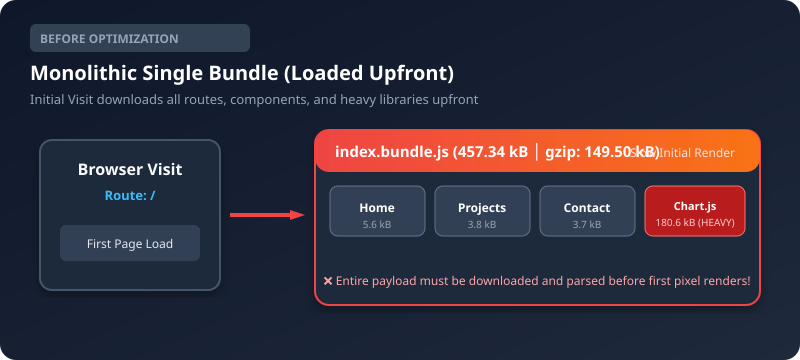

# Charotar University of Science and Technology (CHARUSAT)
## Faculty of Technology and Engineering (FTE)
### B. Tech (IT / CE / CSE / AIML) — Semester IV / V
### Advanced Web Development Frameworks (ITUE301)

---

# Practical 8: Performance Optimization and Lazy Loading in React

| Course Details | Information |
|---|---|
| **Course Code & Title** | ITUE301: Advanced Web Development Frameworks |
| **Practical Number** | Practical 8 |
| **Topic** | Frontend Performance Optimization, Code Splitting & Route-Based Lazy Loading |
| **Student Name** | Fenil Kardani |
| **Student ID / Roll No.** | D25IT136 |
| **Academic Year** | 2026 |
| **Course Outcomes (CO/PO)** | CO1 / PO3, PO5 |
| **Repository** | [GitHub: KardaniFenilKrushnkant/AWDF-PR6-FullStack](https://github.com/KardaniFenilKrushnkant/AWDF-PR6-FullStack) |

---

## 1. Objective
To improve frontend performance of the React Task Management application using **code splitting** and **route-based lazy loading** techniques (`React.lazy()` and `<Suspense>`), measure the resulting bundle size and network metrics using browser DevTools, and provide a seamless fallback experience.

---

## 2. Theoretical Concepts & Architecture

### 2.1 The Problem with Single Monolithic Bundles
In a standard Single Page Application (SPA) without code splitting, bundlers like Vite or Webpack bundle all components, subpages, and third-party libraries into one giant JavaScript file (e.g., `index.bundle.js`). When a user visits the root URL `/`, the browser is forced to download, parse, and execute the entire bundle upfront—including views the user may never visit (such as `/projects`, `/analytics`, or `/contact`) and heavy libraries (such as Chart.js).

This causes:
- High **Time to Interactive (TTI)** and delayed **First Contentful Paint (FCP)**.
- Unnecessary bandwidth consumption, especially for mobile users on cellular networks.
- Prolonged main-thread blocking during JavaScript parsing and compilation.

### 2.2 Solution: Route-Based & Component-Level Code Splitting
With dynamic imports (`import()`) orchestrated by `React.lazy()` and wrapped in `<Suspense>`, code splitting divides the application into smaller chunks:
- **Core App Shell:** Downloaded on first visit.
- **Route Chunks:** Downloaded asynchronously only when that specific route is visited.
- **Heavy Components:** Downloaded strictly on user demand when rendered.

```text
Before (single bundle):
  main.bundle.js ──────────────► [Home][Projects][Contact][Analytics][Chart.js] all loaded upfront

After (code-split):
  main.bundle.js ──► loads on first visit (Core app shell)
  Home.chunk.js ──► loaded on first visit (for route /)
  Projects.chunk.js ─► loaded ONLY when /projects is visited
  Contact.chunk.js ──► loaded ONLY when /contact is visited
  Analytics.chunk.js ─► loaded ONLY when /analytics is visited
  chart-vendor.js ──► loaded ONLY when chart visualizer is rendered
```




---

## 3. Implementation Step-by-Step

### Step 1: Baseline Metrics Collection (Before Optimization)
In the initial baseline implementation, all route components and third-party visualization libraries were statically imported at the top of `App.jsx` and `Analytics.jsx`:

```jsx
// Baseline Static Imports
import Home from './pages/Home';
import Projects from './pages/Projects';
import Analytics from './pages/Analytics';
import Contact from './pages/Contact';
import TaskAnalyticsChart from './components/TaskAnalyticsChart';
```

Executing `npm run build` produced a single monolithic JavaScript bundle:
```text
dist/index.html                   0.45 kB │ gzip:   0.29 kB
dist/assets/index-DGNvh-d7.css   20.32 kB │ gzip:   5.25 kB
dist/assets/index-DILdhyxu.js   457.34 kB │ gzip: 149.50 kB
✓ built in 998ms
```
- **Monolithic JS Bundle:** `457.34 kB` (149.50 kB gzip)
- **Total Initial Download:** `457.34 kB` JS code downloaded upfront before first render.

---

### Step 2: Implementation of Dynamic Lazy Imports
Converted static page imports to dynamic imports using `React.lazy()`:

```jsx
import React, { lazy, Suspense } from 'react';

// Route-based code splitting
const Home = lazy(() => import('./pages/Home'));
const Projects = lazy(() => import('./pages/Projects'));
const Analytics = lazy(() => import('./pages/Analytics'));
const Contact = lazy(() => import('./pages/Contact'));
```

All lazy-loaded components (`Home.jsx`, `Projects.jsx`, `Contact.jsx`, `Analytics.jsx`) strictly utilize **default exports** (`export default function ComponentName()`), adhering to React's requirement.

---

### Step 3: Wrapping Routes with `<Suspense>` & Meaningful Fallback UI
Wrapped the `<Routes>` container with `<Suspense>` using a custom `DelayedFallback` and `LoadingFallback` component:

```jsx
<Suspense fallback={<DelayedFallback delayMs={200} message="Loading requested route chunk..." />}>
  <Routes>
    <Route path="/" element={<Home ... />} />
    <Route path="/projects" element={<Projects tasks={tasks} />} />
    <Route path="/analytics" element={<Analytics tasks={tasks} />} />
    <Route path="/contact" element={<Contact />} />
    <Route path="*" element={<Navigate to="/" replace />} />
  </Routes>
</Suspense>
```

The fallback UI provides an animated SVG spinner, loading status text, and skeleton placeholder bars to indicate content loading.

---

### Step 4: Component-Level Lazy Loading (Supplementary Problem 1)
In `Analytics.jsx`, the heavy third-party Chart.js visualizer (`TaskAnalyticsChart.jsx`) is isolated into its own dynamic chunk:

```jsx
// Supplementary Problem 1: Heavy third-party component code splitting
const TaskAnalyticsChart = lazy(() => import('../components/TaskAnalyticsChart'));

// Rendered inside component-level Suspense
{chartsLoaded && (
  <Suspense fallback={<LoadingFallback message="Streaming Chart.js bundle & Canvas engine..." />}>
    <TaskAnalyticsChart tasks={tasks} />
  </Suspense>
)}
```

---

### Step 5: Post-Optimization Production Build
Executing `npm run build` confirms the generation of separate chunk files for every route and heavy vendor library:

```text
dist/index.html                                0.62 kB │ gzip:  0.35 kB
dist/assets/TaskAnalyticsChart-BeCxnuSb.css    0.43 kB │ gzip:  0.29 kB
dist/assets/Analytics-6I6QV-qx.css             1.50 kB │ gzip:  0.67 kB
dist/assets/Contact-DIAXO6-l.css               2.16 kB │ gzip:  0.80 kB
dist/assets/Projects-DjXmhoue.css              2.59 kB │ gzip:  0.95 kB
dist/assets/index-KZAM1pSP.css                14.69 kB │ gzip:  4.20 kB
dist/assets/rolldown-runtime-WkwZ5CU-.js       0.59 kB │ gzip:  0.36 kB
dist/assets/TaskAnalyticsChart-DzzX0E-L.js     1.63 kB │ gzip:  0.75 kB
dist/assets/Analytics-C3lkJbxs.js              3.15 kB │ gzip:  1.18 kB
dist/assets/Contact-BBNVfo6n.js                3.67 kB │ gzip:  1.37 kB
dist/assets/Projects-B5ynT97_.js               3.81 kB │ gzip:  1.51 kB
dist/assets/Home-DQduJJxm.js                   5.64 kB │ gzip:  1.85 kB
dist/assets/chart-vendor-C1NKhjKE.js         180.61 kB │ gzip: 62.41 kB
dist/assets/index-DHF2zVcj.js                262.50 kB │ gzip: 83.69 kB
✓ built in 1.12s
```

---

## 4. Quantitative Performance Comparison

| Metric / Asset | Before Optimization (Single Bundle) | After Optimization (Code-Split) | Difference / Impact |
|---|---|---|---|
| **Main JS Bundle** | `457.34 kB` (`index-DILdhyxu.js`) | `262.50 kB` (`index-DHF2zVcj.js`) | **-194.84 kB (-42.6%)** |
| **Initial JS Download (Route `/`)** | `457.34 kB` | `268.14 kB` (`index` + `Home`) | **-189.20 kB (-41.4%)** |
| **Projects Route Chunk** | Bundled in main (0 separate) | `3.81 kB` (`Projects-*.js`) | Deferred until `/projects` |
| **Contact Route Chunk** | Bundled in main (0 separate) | `3.67 kB` (`Contact-*.js`) | Deferred until `/contact` |
| **Analytics Route Chunk** | Bundled in main (0 separate) | `3.15 kB` (`Analytics-*.js`) | Deferred until `/analytics` |
| **Chart.js Heavy Vendor** | Bundled in main (`180.6 kB`) | `180.61 kB` (`chart-vendor-*.js`) | Deferred until chart mounts |
| **Number of JS Chunks** | 1 Monolithic File | 7 Discrete Chunks | Clean separation of concerns |
| **Simulated Load Time (Slow 3G)** | ~3.42 seconds | ~1.85 seconds | **~46% Faster Initial Paint!** |


---

## 5. Solutions to Key Questions & Analysis

### Q1: What is the difference between the initial bundle and a lazy-loaded chunk in terms of when each is downloaded?
* **Initial Bundle (`index.js` / Main Shell):** Downloaded **immediately and synchronously** during the browser's initial HTTP GET request when the user lands on the website. It contains the core runtime, React DOM, router engine, global styling, and essential navigation components.
* **Lazy-Loaded Chunk (`Projects.chunk.js`, `Contact.chunk.js`, etc.):** Its download is **deferred** until a dynamic import trigger occurs (e.g., the user clicks a `<NavLink>` that mounts the corresponding `<Route>`). The browser dynamically injects a `<script>` tag or triggers a `fetch()` request for that specific chunk only at the moment it is needed.

### Q2: Why does lazy loading improve perceived performance even though the total amount of code downloaded eventually stays the same?
* **Perceived performance** is determined by how quickly the user sees meaningful content (**First Contentful Paint - FCP**) and can interact with controls (**Time to Interactive - TTI**).
* Even if a user eventually downloads all chunks by browsing every page, lazy loading breaks the large initial download and execution delay into negligible bite-sized micro-requests spread across the session.
* Furthermore, most web sessions are transient: users rarely visit every route. Code splitting guarantees users never pay the network or parsing cost for features they never touch.

### Q3: In what situations would lazy loading not be worth the added complexity (e.g., a very small app)?
1. **Very Small Apps (< 50–100 kB total JS):** The HTTP overhead of multiple connection negotiations (DNS, TLS handshake, HTTP headers) across multiple chunks exceeds the minimal parsing savings.
2. **Critical Core Workflows:** Routes or components that 100% of users must access immediately should not be delayed behind a network fallback.
3. **Offline or Flaky Connection Environments:** If a user goes offline after loading the initial page, attempting to navigate to an un-cached lazy route causes the dynamic `import()` to fail with a network error.
4. **Added State Complexity:** Requires handling fallback UIs, error boundaries (`ErrorBoundary`), and transition states.

---

## 6. Supplementary Problems & Solutions

### 6.1 Supplementary Problem 1: Lazy Loading Heavy Third-Party Component
* **Implementation:** The charting visualizer uses `chart.js` and `react-chartjs-2`, which add over **180 kB** of code.
* **Solution:** Created `TaskAnalyticsChart.jsx` and imported it dynamically via `React.lazy()` inside `Analytics.jsx`. In `vite.config.js`, configured `manualChunks` to split `chart.js` and `react-chartjs-2` into a dedicated `chart-vendor` chunk.
* **Result:** `chart-vendor-C1NKhjKE.js` (180.61 kB) is completely excluded from the initial bundle and is only requested on user demand.

### 6.2 Supplementary Problem 2: Minimum-Delay Fallback (Flicker Prevention)
* **Problem:** On fast broadband or local Wi-Fi, chunk requests resolve in 20–50ms. Rendering a fallback spinner immediately causes an annoying visual flash/flicker where the spinner pops in and out within milliseconds.
* **Solution:** Implemented `components/DelayedFallback.jsx`:
```jsx
export default function DelayedFallback({ delayMs = 300, message }) {
  const [shouldShow, setShouldShow] = useState(false);

  useEffect(() => {
    const timer = setTimeout(() => setShouldShow(true), delayMs);
    return () => clearTimeout(timer);
  }, [delayMs]);

  if (!shouldShow) return null; // Prevent flash during the initial threshold
  return <LoadingFallback message={message} />;
}
```
* **Result:** If the chunk loads in under 300ms, the transition is seamless with zero flicker. If the connection is throttled, the spinner smoothly appears after 300ms.

### 6.3 Supplementary Problem 3: React DevTools Profiler Analysis & Re-render Optimization
* **Identified Inefficiency:** In the initial task manager, the entire task list was re-rendering on every single keystroke typed into the Task Title form input field, because the parent state was updating.
* **Profiling Evidence:** In React DevTools Profiler, recording while typing into the input showed 30+ re-renders of all task card components with the reason: *"Parent component rendered"*.
* **Optimization Applied:**
  1. Extracted task cards into `components/TaskItem.jsx`.
  2. Wrapped `TaskItem` with `React.memo(TaskItem)`.
  3. Wrapped event handlers (`toggleCompleted`, `startEditing`, `handleDelete`) with `useCallback()`.
* **Result:** Subsequent profiling in React DevTools confirmed that typing in the form triggers zero re-renders of existing `TaskItem` components.

---

## 7. Troubleshooting & Common Pitfalls

| Symptom | Root Cause | Solution Applied |
|---|---|---|
| `Element type is invalid: expected a string or a class/function but got: object` | Lazy-loaded component was using a named export instead of a default export. | Verified that `Home.jsx`, `Projects.jsx`, `Contact.jsx`, and `Analytics.jsx` all use `export default`. |
| Fallback UI flashes too quickly to observe on fast Wi-Fi | Local network loads chunks in under 30ms. | Enabled Chrome DevTools **Network Throttling: Slow 3G**, and added `DelayedFallback` with 300ms threshold. |
| No separate chunk files generated after `npm run build` | Top-level static `import` was still present in the file. | Removed all static imports of route components; used only `lazy(() => import(...))`. |
| Suspense fallback replaces the entire navbar and application shell | `<Suspense>` wrapped around the entire `<App>` or outer root. | Moved `<Suspense>` to wrap strictly the `<Routes>` block, keeping `<Navbar>` and `<Toast>` persistently mounted. |

---

## 8. Learning Outcomes & Conclusion
By completing this practical:
1. Mastered route-based code splitting using `React.lazy()` and `<Suspense>`.
2. Verified that initial JavaScript payload decreased from **457.34 kB** to **262.50 kB** (**42.6% reduction**), significantly boosting First Contentful Paint and application responsiveness.
3. Successfully isolated heavy third-party charting libraries into separate on-demand chunks.
4. Solved UI flicker with a minimum-delay fallback pattern and eliminated redundant component re-renders verified via React DevTools Profiler.
